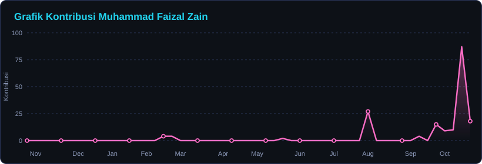
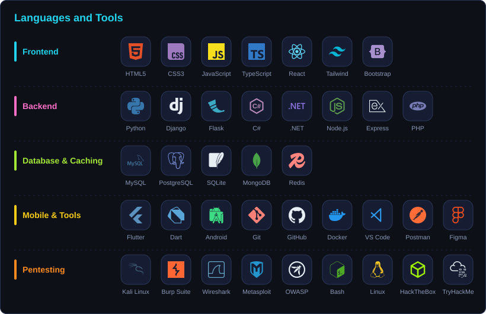
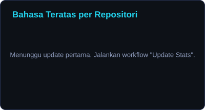
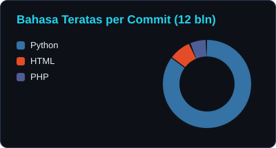
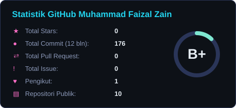
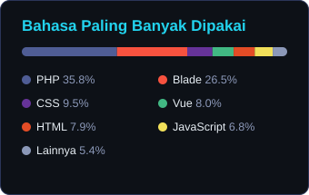
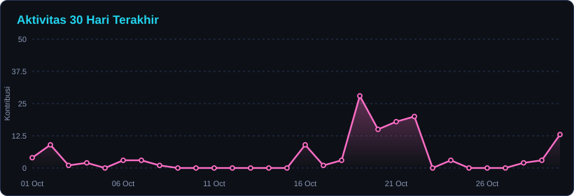

<!-- Ganti semua placeholder: USERNAME, Nama Kamu, link sosial media, dan nama repo -->

<!-- BANNER: upload file banner.png (satu folder dengan README ini) ke repositori profil kamu -->

  

Saya **Nama Kamu**, saat ini sedang menempuh S1 **Computer Science** di **Nama Kampus**. Saya seorang tech enthusiast, desainer, dan open-source advocate. Saya selalu terbuka untuk berkolaborasi pada proyek dan ide-ide inovatif. Kalau sedang tidak ngoding, kamu bisa menemukan saya sedang angkat beban di gym atau di depan meja sambil mengutak-atik hal baru.

Cari tahu lebih banyak tentang saya & jangan ragu untuk terhubung dengan saya di sini:

  
  
  
  
  
  

  

 

## 🛠️ Languages and Tools:

  

  
  

 

## 📺 Video YouTube Terbaru

<!-- YOUTUBE:START -->
- [Judul video terbaru 1](https://www.youtube.com/@USERNAME)
- [Judul video terbaru 2](https://www.youtube.com/@USERNAME)
<!-- YOUTUBE:END -->

 

## 🏅 Proyek Open Source yang Terbuka untuk Kontribusi

| 📁 Proyek | ⭐ Stars | 🍴 Forks | 🐛 Issues | 🔀 Pull Requests | 💻 Bahasa |
| --- | --- | --- | --- | --- | --- |
| [nama-repo-1](https://github.com/USERNAME/nama-repo-1) |  |  |  |  |  |
| [nama-repo-2](https://github.com/USERNAME/nama-repo-2) |  |  |  |  |  |
| [nama-repo-3](https://github.com/USERNAME/nama-repo-3) |  |  |  |  |  |

 

<b>📊 GitHub Stats (Klik untuk Melihat)</b>

 

📈 Statistik Profil GitHub

 

  
  

  <i>Catatan: Bahasa teratas hanya menghitung bahasa pada kode publik saya dan tidak mencerminkan pengalaman atau tingkat keahlian.</i>

🔥 Aktivitas GitHub Terbaru

 

  

 

## 🤝 Ayo Terhubung

  &nbsp;
  &nbsp;
  &nbsp;
  &nbsp;
  &nbsp;
  

